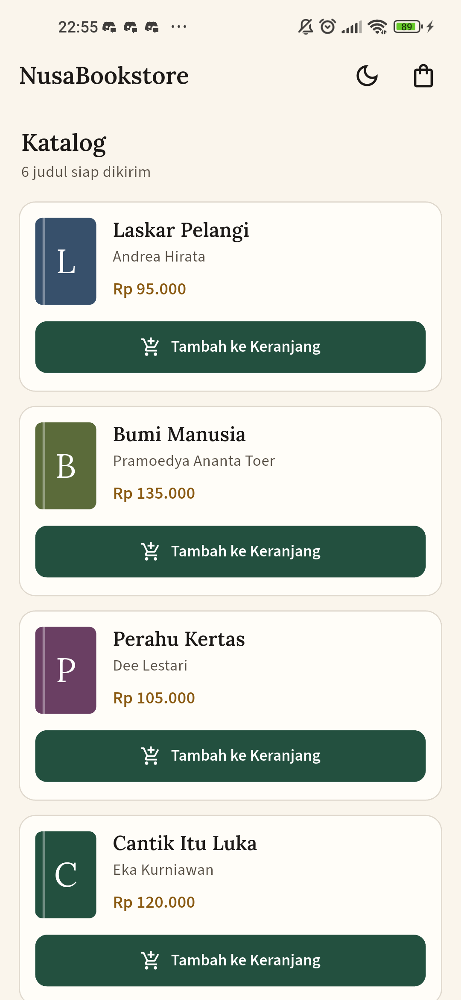
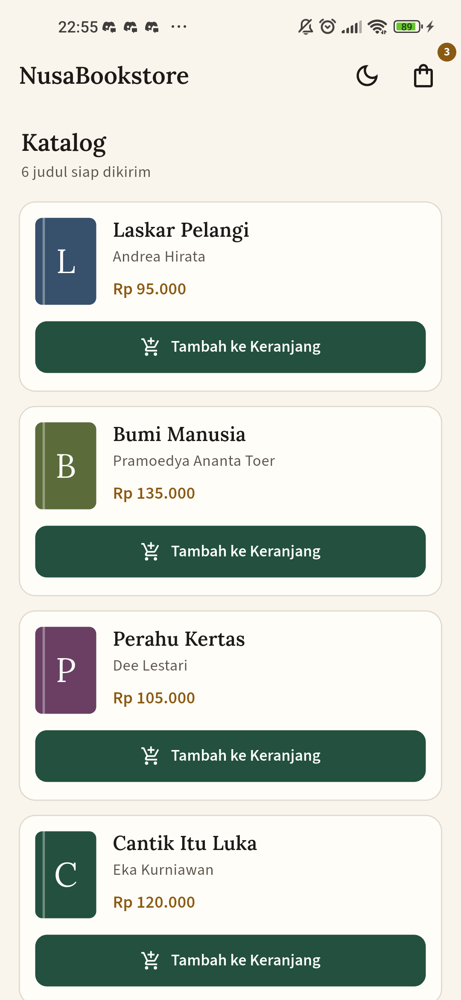
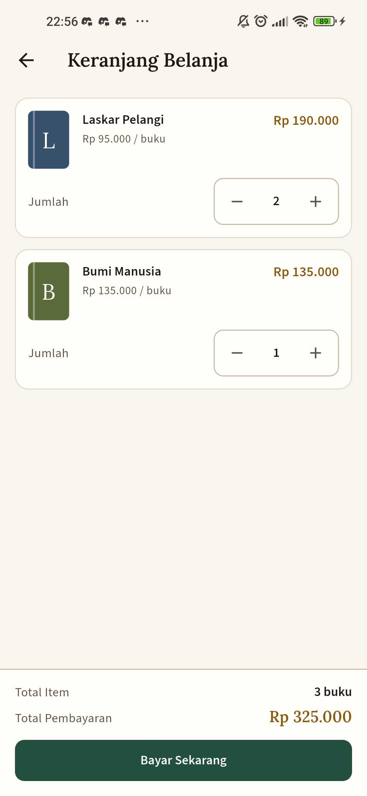
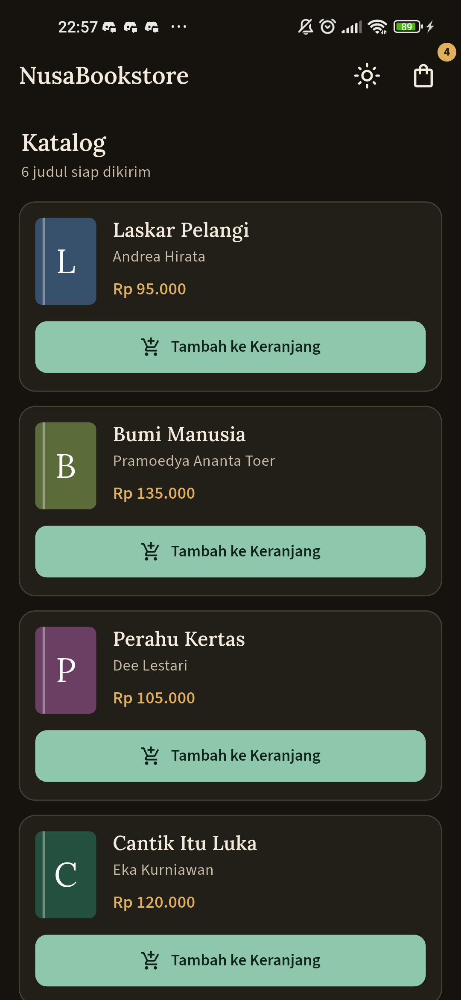
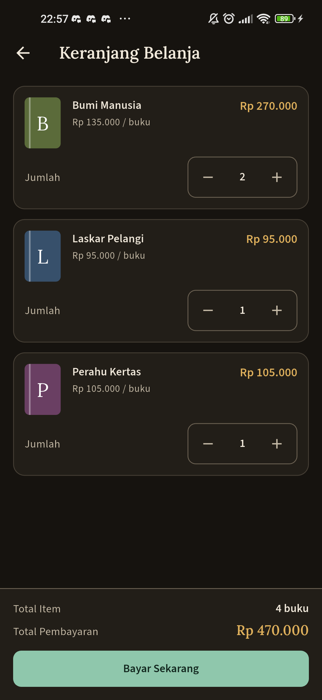
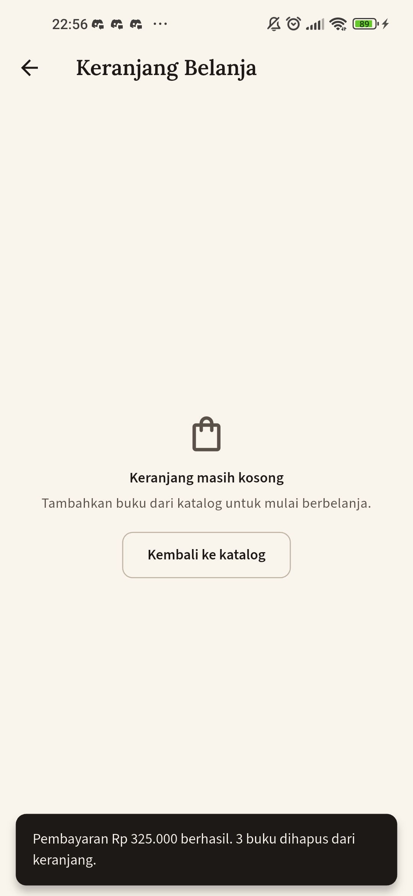

# NusaBookstore

Aplikasi katalog dan keranjang buku sederhana dengan Flutter, memakai **Provider** untuk state management.

## Fitur

- Katalog buku (6 judul) memakai `Card` di dalam `ListView`.
- Badge jumlah item pada ikon keranjang di `AppBar`, berubah otomatis saat buku ditambahkan.
- Halaman keranjang: daftar buku, jumlah tiap buku, tombol `-` dan `+`, Total Item, dan Total Pembayaran dalam format Rupiah.
- Tombol Bayar Sekarang menampilkan `SnackBar` lalu mengosongkan keranjang.
- Toggle Light/Dark Mode yang langsung berlaku ke seluruh aplikasi.

## Struktur folder

```
lib/
├── models/
│   └── book.dart
├── providers/
│   ├── cart_provider.dart
│   └── theme_provider.dart
├── screens/
│   ├── catalog_screen.dart
│   └── cart_screen.dart
└── main.dart
```

## State management

- `CartProvider` (`ChangeNotifier`): daftar item, `addItem()`, `removeItem()`, `clearCart()`, `totalItems`, dan `totalPrice`. Setiap perubahan memanggil `notifyListeners()`.
- `ThemeProvider` (`ChangeNotifier`): `isDark`, `themeMode`, dan `toggleTheme()`.
- Keduanya didaftarkan lewat `MultiProvider` di root aplikasi.
- `MaterialApp` dibungkus `Consumer<ThemeProvider>` agar perubahan tema langsung berlaku ke seluruh aplikasi.
- `context.watch()` dipakai untuk data yang perlu rebuild, `context.read()` untuk memicu aksi seperti menambah buku.

## Menjalankan

```
flutter pub get
flutter run
```

Menjalankan pengujian:

```
flutter test
```

## Screenshot

Screenshot diambil langsung dari HP Android (Redmi Note 9, Android 12) dan tersimpan di `docs/screenshots/`.

### 1. Halaman katalog (mode terang)



### 2. Badge jumlah keranjang



### 3. Halaman keranjang dan total pembayaran (mode terang)



### 4. Halaman katalog (mode gelap)



### 5. Halaman keranjang (mode gelap)



### 6. SnackBar setelah checkout



## Catatan data

Judul dan penulis memakai buku nyata. Harga yang ditampilkan adalah contoh harga toko, bukan data penjualan langsung.

## Catatan desain

Identitas "paper and ink" untuk toko buku: kertas hangat dan tinta pekat sebagai netral, hijau pinus sebagai warna utama, dan kuningan sebagai satu-satunya aksen untuk harga serta tombol Bayar. Judul memakai Lora (serif literer), antarmuka memakai Source Sans 3. Sampul buku dirender sebagai punggung tipografis karena katalog contoh tidak menyertakan berkas cover asli.

Kedua font berlisensi OFL dan disertakan di `assets/fonts`.
